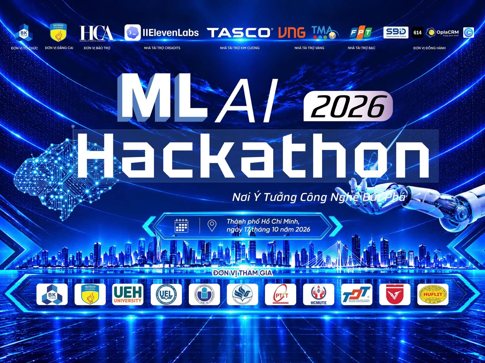
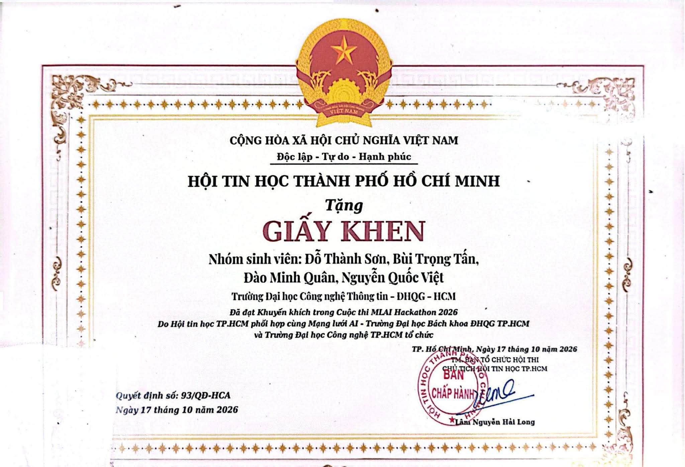
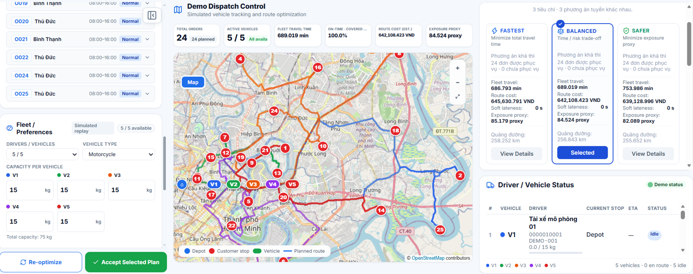
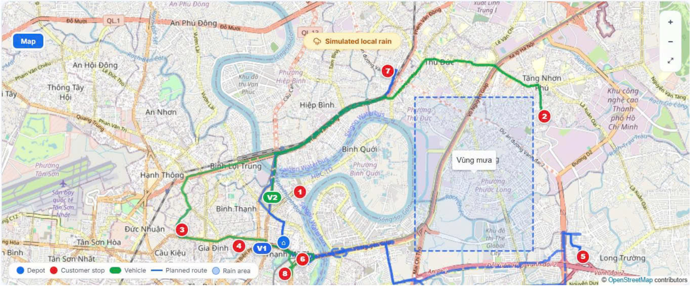
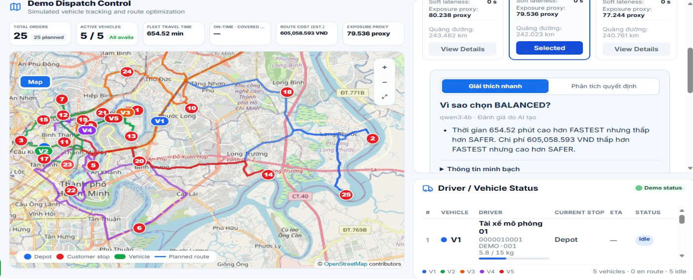
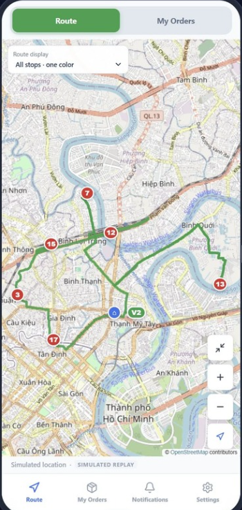
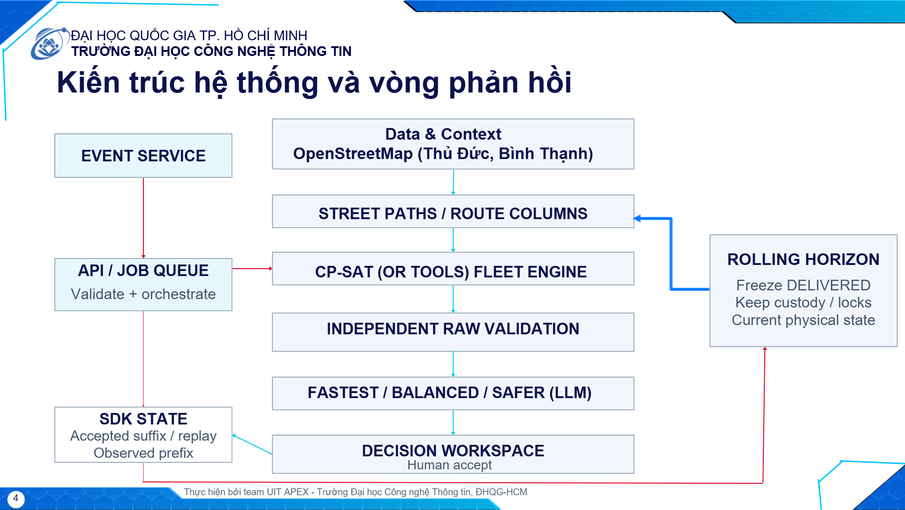
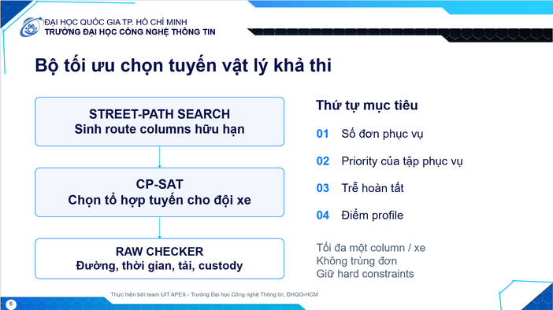

# SafeRoute VN

> **Safety- and Uncertainty-Aware Dynamic Last-Mile Decision Intelligence for Motorcycle-Centric SMEs**

**MLAI Hackathon 2026 · Track 3 — Decision Intelligence**  
**Team UIT APEX · University of Information Technology — VNU-HCM**

### 🏆 Awards

🥉 **3rd Place — TMA Track 3: Decision Intelligence**  
🏅 **Honorable Mention — MLAI Hackathon 2026 Overall**



---

## 1. MLAI Track TMA

### MLAI Hackathon 2026 — Track 3: Decision Intelligence

Track 3 by TMA focuses on intelligent systems that help a specific user group make better decisions by:

- identifying decision objectives,
- aggregating relevant information,
- comparing alternatives,
- explaining trade-offs,
- and keeping the final decision under human control.

SafeRoute VN applies this idea to last-mile logistics for SMEs.

### The Problem

A dispatcher must answer several questions at the same time:

- Which order should be assigned to which vehicle?
- In what sequence should the orders be delivered?
- Which physical street path should each vehicle follow?
- When operational conditions change, how should the future plan be updated without invalidating what has already happened?

SafeRoute VN is therefore not simply a multi-stop map application. It is a **human-in-the-loop Decision Intelligence layer** that combines road data, operational context, optimization, uncertainty, alternative plans, and traceable decision support.

---

## 2. Target Users

### Dispatcher / SME Owner

The dispatcher is responsible for:

- monitoring fleet and order status,
- requesting optimization,
- comparing alternative plans,
- selecting the most appropriate trade-off,
- accepting the final plan,
- and re-optimizing when new events occur.

### Driver

The driver uses the accepted plan to:

- view assigned orders,
- follow the optimized delivery sequence,
- inspect route and delivery information,
- track onboard orders and current delivery state,
- and update delivery progress.

The primary scope of SafeRoute VN is **retail and local parcel delivery SMEs with motorcycle-based fleets**.

---

## 3. What is SafeRoute VN?

SafeRoute VN is a dynamic delivery decision-support system for SMEs with their own motorcycle fleet.

It combines:

- motorcycle-oriented street routing,
- fleet optimization,
- operational constraints,
- weather and exposure context,
- dynamic rolling-horizon re-optimization,
- and human-controlled plan acceptance.

The system generates three alternatives — **FASTEST, BALANCED, and SAFER** — so the dispatcher can compare trade-offs before making the final decision.

```text
Context → Routes → Optimize → Compare → Human Accept → Execute → Re-optimize
```

---

## 4. UI

### Admin Dashboard


<p align="center">
  
  
</p>

### Driver Application
<p align="center">
  
</p>

---

## 5. Why SafeRoute VN?

### Motorcycle-Centric Routing

SafeRoute VN builds routing logic around motorcycle-oriented road access, directed street graphs, turn restrictions, and route provenance.

### Safety & Weather-Aware Decisions

The system considers not only travel time but also a transparent **relative exposure proxy**, allowing the dispatcher to compare time–exposure trade-offs.

> Exposure is an engineering proxy, not a calibrated crash probability.

### Dynamic Rolling-Horizon Re-optimization

When an operational event occurs, SafeRoute VN does not blindly rebuild the whole plan.

It preserves:

- delivered history,
- custody and onboard orders,
- current vehicle position and load,
- active commitments,

and re-optimizes only the flexible future.

### Human-in-the-Loop Decision Support

SafeRoute VN does not automatically dispatch a newly optimized plan.

The system proposes alternatives, explains their trade-offs, and the **dispatcher remains the final decision owner**.

---

## 6. Workflow Architecture



---

## 7. Optimization Engine

SafeRoute VN uses a **two-level optimization design**.



---

## 8. FASTEST · BALANCED · SAFER

SafeRoute VN provides three alternatives using the **same operational state and hard constraints**.

| Profile | Main Priority |
|---|---|
| ⚡ **FASTEST** | Minimize travel time |
| ⚖️ **BALANCED** | Balance travel time and modeled exposure |
| 🛡️ **SAFER** | Minimize modeled exposure |

The profiles differ in route selection and optimization priorities, not in feasibility rules.

A SAFER plan, for example, is still required to respect capacity, deadlines, custody, legal route continuity, and other hard constraints.

---

## 9. SafeRoute Driver for Android

SafeRoute VN includes a finalized **Android Driver application (APK)** for the driver-side workflow.

The Driver App allows drivers to:

- connect to the SafeRoute backend,
- join an existing delivery session,
- view the dispatcher-accepted plan,
- inspect assigned orders and route information,
- view vehicle/load/onboard-order state,
- follow delivery progress,
- and confirm deliveries.

The Driver application is intentionally separated from Admin authority.

Driver-side operations do **not** expose administrative actions such as:

- Optimize,
- Select,
- Accept,
- Reset,
- or scenario-management actions.

This separation keeps the dispatcher as the decision owner while giving the driver only the controls required to execute the accepted plan.

---

## © Copyright & Usage

© 2026 **UIT APEX**. All rights reserved.

All source code, system design, documentation, visual materials, datasets, demo assets, and related project content of **SafeRoute VN** are intellectual property of **UIT APEX**, unless otherwise stated.

Any use, reproduction, modification, redistribution, publication, presentation, or reuse of this project or any part of it requires prior permission from UIT APEX.

For permission or usage requests, please contact:

📧 **buitrongtan2408@gmail.com**
