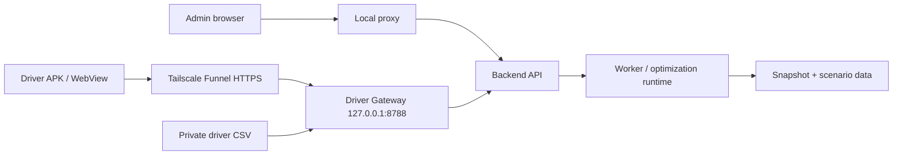

# Kiến trúc

Thư mục ứng dụng: `SafeRouteVN_Portable_Win64_20261014`.

| Thư mục | Vai trò |
|---|---|
| `frontend` | React/TypeScript cho Admin và Driver; Vite phục vụ local, `dist-driver` phục vụ Driver Gateway |
| `backend` | HTTP API, xác thực, phiên điều phối và quản lý tác vụ |
| `optimization` | Mô hình, solver, profiles và runtime xử lý tối ưu |
| `geo_data` | Mạng đường, đặc trưng cạnh, chính sách phương tiện và ngữ cảnh thời tiết |
| `shared` | Hợp đồng dữ liệu, schema và ví dụ |
| `scenarios` | Fixtures, manifests và cached context tải từ Hugging Face |
| `deployment` | Driver Gateway và đồng bộ tài khoản từ CSV riêng |
| `portable` | Python backend, Python runtime và Node đã đóng gói |
| `portable-state` | Cài đặt local, token, cơ sở dữ liệu và receipts phát sinh |

BAT chạy gọi bootstrap portable rồi launcher. Bootstrap kiểm manifest, native
solver và tạo cài đặt riêng. Launcher quản lý tiến trình thuộc cài đặt đó.

`production_inventory.json` ghim source runtime; `portable/manifest.json` ghim
các file của gói chạy. Bộ cài khôi phục đúng byte và đúng đường dẫn từ ba phần:
source GitHub, runtime GitHub Releases và data Hugging Face.

Các JSON cấu hình, schema và policy thuộc source vẫn ở GitHub. JSON fixture,
snapshot và scenario chuyển sang Hugging Face. Không có token nhúng trong APK.

Driver được xác thực và giới hạn theo phiên được cấp. Không coi việc các tài xế
cùng phiên nhìn thấy dữ liệu phiên là cơ chế cô lập dữ liệu từng xe.
